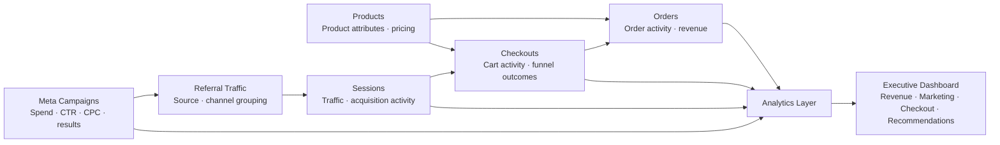

# Breaking Games E-Commerce Analytics Dashboard

**SQL & Database Analytics Externship Portfolio Project**  
**Focus:** E-commerce analytics · marketing attribution · product performance · checkout behavior · executive reporting

This repository showcases the final analytics dashboard I developed during the **Breaking Games SQL & Database Architecture Externship**. The project brought together e-commerce, product, referral, checkout, session, and Meta advertising data to support business decision-making around **revenue concentration, customer acquisition, advertising efficiency, and checkout friction**.

> **Confidentiality note:** The original SQL queries, SQLite database, proprietary source datasets, exact production schema, and confidential company information are intentionally excluded in accordance with externship restrictions. This repository presents only the final dashboard, high-level analytical methodology, public portfolio insights, and a simplified conceptual data model.

---

## Executive Summary

The objective was to turn fragmented e-commerce data into a concise decision-support dashboard for Q4 planning. I analyzed multiple business datasets in a relational SQLite environment, validated KPI definitions, grouped hundreds of referral sources into business-friendly acquisition channels, evaluated product and campaign performance, and translated the analysis into an interactive **HTML + Chart.js executive dashboard**.

### Portfolio Highlights

- Consolidated analysis across **6 e-commerce data sources**.
- Categorized **400+ referral sources** into meaningful acquisition channels.
- Identified that approximately **13 of 99 products generated ~80% of revenue**.
- Flagged approximately **2.6% of carts** as potentially suspicious based on unusually high quantities during exploratory quality checks.
- Challenged an initial **91.2% checkout-abandonment estimate** and refined the analysis to approximately **50.8% for July 2025** after aligning comparable time periods.
- Built an executive-facing dashboard covering revenue, product performance, traffic quality, Meta campaigns, shipping, and checkout behavior.

---

## Business Questions

The dashboard was designed around four core questions:

1. **Revenue Performance** — Which products generate the most revenue, and how concentrated is revenue across the catalog?
2. **Traffic Quality** — Which acquisition channels generate meaningful traffic and stronger downstream performance?
3. **Advertising Efficiency** — Which Meta campaigns show strong engagement and cost efficiency, and which require review?
4. **Checkout Friction** — Where do checkout-to-order gaps appear, and what product or geographic factors may contribute?

---

## Data Sources

The externship analysis used six business data domains:

- Orders
- Products
- Checkouts
- Website sessions
- Referral traffic
- Meta advertising campaigns

The underlying data was analyzed in a relational **SQLite** environment. Exact table definitions, join logic, keys, and SQL transformations are not published.

---

## Conceptual Data Model

The diagram below is intentionally simplified for portfolio presentation. It illustrates the **analytical relationships** used to connect commercial activity without reproducing Breaking Games' proprietary database schema.



### High-Level Analytical Flow

```text
Raw Business Data
       │
       ├── Orders
       ├── Products
       ├── Checkouts
       ├── Sessions
       ├── Referral Traffic
       └── Meta Campaigns
              │
              ▼
     Relational Analysis Layer
       • data validation
       • channel grouping
       • KPI calculations
       • product analysis
       • funnel analysis
       • campaign analysis
              │
              ▼
      Executive Dashboard
       • revenue performance
       • marketing efficiency
       • checkout behavior
       • business recommendations
```

> This is a conceptual model only. It does **not** reveal the original schema, SQL, field names, production keys, or confidential transformation logic.

---

## Analytical Approach

### 1. Data Preparation & Quality Review

Before calculating business KPIs, I reviewed the source data for structural and behavioral issues and prepared analysis-ready views in SQLite.

Key activities included:

- Validating relationships across transaction and traffic datasets
- Standardizing fields used for comparative analysis
- Reviewing cart behavior for unusual quantities
- Checking time periods before calculating funnel metrics
- Separating analytical assumptions from confirmed business outcomes

Approximately **2.6% of carts were flagged as potentially suspicious** during exploratory quality checks because of unusually high item quantities. The purpose was not to label those sessions definitively as bots, but to prevent abnormal activity from being ignored during interpretation.

### 2. Marketing Channel Attribution

More than **400 referral sources** were grouped into business-friendly categories including:

- Email
- Community / Referral
- Organic Search
- Direct
- Paid Social
- Other

This converted raw referral information into a channel-level view that was easier to compare and communicate to stakeholders.

### 3. Product & Revenue Analysis

I evaluated revenue contribution, selling price, product ranking, and cumulative revenue concentration.

A Pareto-style analysis showed that approximately **13 of 99 products contributed about 80% of total revenue**, indicating a highly concentrated product mix and highlighting the importance of availability, replenishment, and merchandising decisions for top sellers.

### 4. Checkout & Funnel Validation

One of the most important analytical lessons from the project came from checkout-abandonment measurement.

An initial historical comparison produced an abandonment estimate of approximately **91.2%**. Rather than accepting the number at face value, I reviewed the underlying periods and found that mismatched date coverage could materially distort the KPI.

After aligning the calculation to a comparable period, the adjusted abandonment estimate was approximately **50.8% for July 2025**.

> **A technically correct calculation can still produce a misleading business conclusion if the metric definition, time window, or denominator is wrong.**

---

## Key Findings

### Revenue Performance

- Approximately **13 products account for ~80% of revenue**.
- The **Dwellings of Eldervale** product family appears among the strongest revenue-generating products.
- **Dwellings of Eldervale 2nd Edition** has an Average Selling Price of approximately **$103.28**, compared with a catalog average of approximately **$30.98**.

### Traffic Quality

- **Organic Search** generated approximately **79,556 pageviews** and **378 checkout sessions**.
- **Email** and **Community / Referral** showed stronger reported conversion efficiency at lower traffic volumes.
- **Paid Social** produced meaningful traffic but weaker reported downstream conversion performance.

### Meta Advertising Efficiency

- **Traffic TOF** generated approximately **39,419 recorded results** at about **$0.22 per result**.
- **Dwellings LPV** showed strong engagement at approximately **$0.24 per result**.
- **Sales ATC** recorded the highest CTR at approximately **2.507%**.
- **DA | Sales** represented approximately **$12.9K in spend with zero recorded results**, making tracking validation and budget review an important follow-up area.

### Checkout Behavior

- Several products showed large observed checkout-to-order gaps that warranted deeper investigation.
- International abandoned checkouts were associated with materially higher shipping costs than U.S. checkouts.
- Checkout volume was also compared by billing country using both counts and percentage share.

---

## Dashboard Features

The interactive dashboard includes:

- KPI summary cards
- Product revenue leaderboard
- Revenue distribution analysis
- Average Selling Price analysis with catalog benchmark
- Cumulative revenue concentration / Pareto analysis
- Marketing traffic mix
- Channel conversion comparison
- Meta campaign performance table
- Campaign engagement vs. cost-efficiency analysis
- Meta ad spend by campaign
- Product checkout outcome analysis
- Average shipping cost by billing country
- Checkout volume and percentage by billing country
- Q4 recommendations

---

## Q4 Business Recommendations

Based on the analysis, I recommended:

- Prioritizing inventory availability and replenishment for the relatively small group of products driving most revenue
- Continuing to strengthen **Organic Search** while testing controlled growth in **Email** and **Community / Referral** channels
- Maintaining efficient Meta traffic campaigns while reviewing high-spend campaigns with unclear recorded outcomes
- Investigating product pricing, shipping transparency, product availability, and international shipping costs where checkout gaps are largest
- Improving attribution and campaign tracking so marketing spend can be connected more directly to orders and revenue

---

## Technologies & Skills

### Technologies

- SQL
- SQLite
- HTML
- CSS
- JavaScript
- Chart.js
- Tailwind CSS

### Analytical Skills Demonstrated

- Relational data analysis
- Data cleaning and validation
- KPI development
- Marketing channel attribution
- Revenue and product performance analysis
- Pareto analysis
- Funnel / abandonment analysis
- Campaign performance analysis
- Data-quality investigation
- Executive dashboard design
- Business storytelling and recommendations

---

## Repository Structure

```text
BreakingGameDashboard/
│
├── index.html     # Final interactive dashboard deliverable
└── README.md      # Portfolio case study and methodology
```

The repository intentionally does **not** contain the externship's proprietary datasets, SQLite database, SQL scripts, or confidential source files.

---

## What This Project Demonstrates

This project represents more than dashboard creation. It demonstrates my ability to work through the full analytics lifecycle:

**Business Question → Data Validation → Relational Analysis → KPI Development → Investigation → Visualization → Recommendation**

A key example was the checkout-abandonment analysis: instead of reporting an unusually high result without question, I investigated the metric definition and date coverage, corrected the analytical framing, and produced a more defensible business KPI.

That combination of **technical analysis, data-quality judgment, and business communication** is the type of work I aim to bring to Data Analyst, BI, Analytics Engineering, and data-focused operations roles.

---

## Author

**Muzammil Paracha**  
Data Analytics · SQL · Power BI · Databricks · Business Intelligence · Data Engineering

*Project completed as part of the Breaking Games SQL & Database Architecture Externship.*
